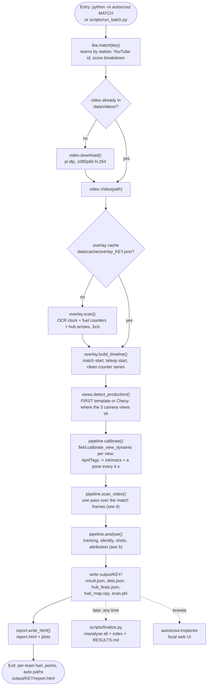
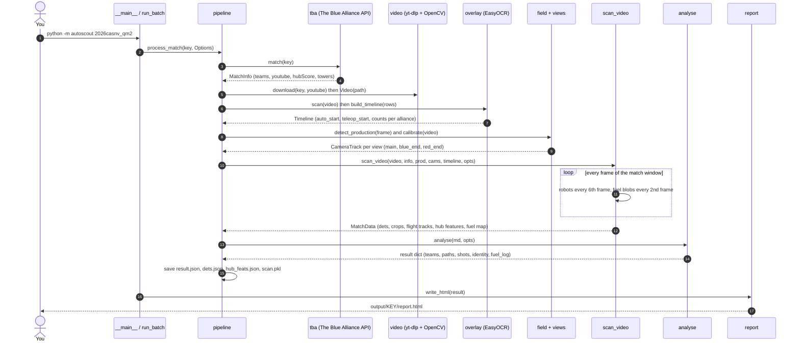
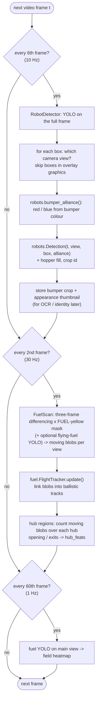
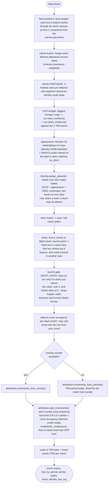
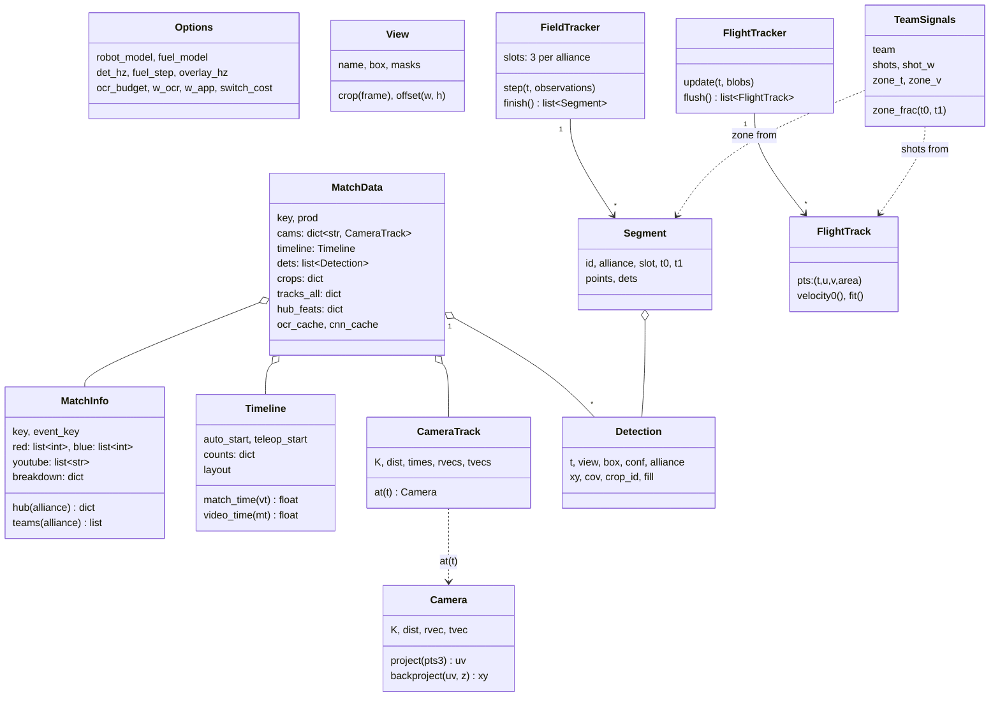
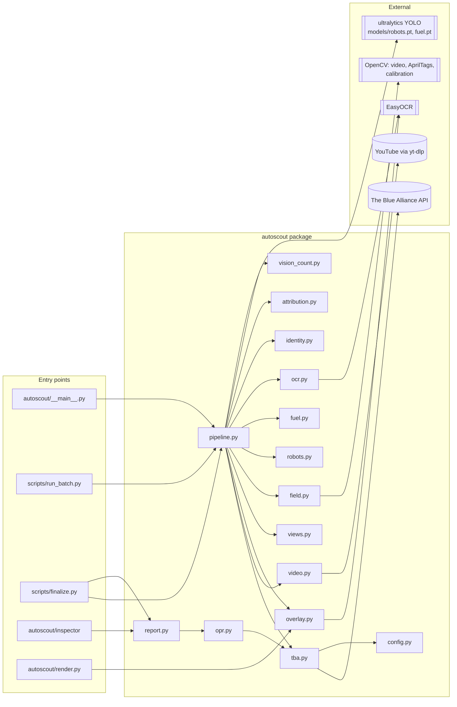
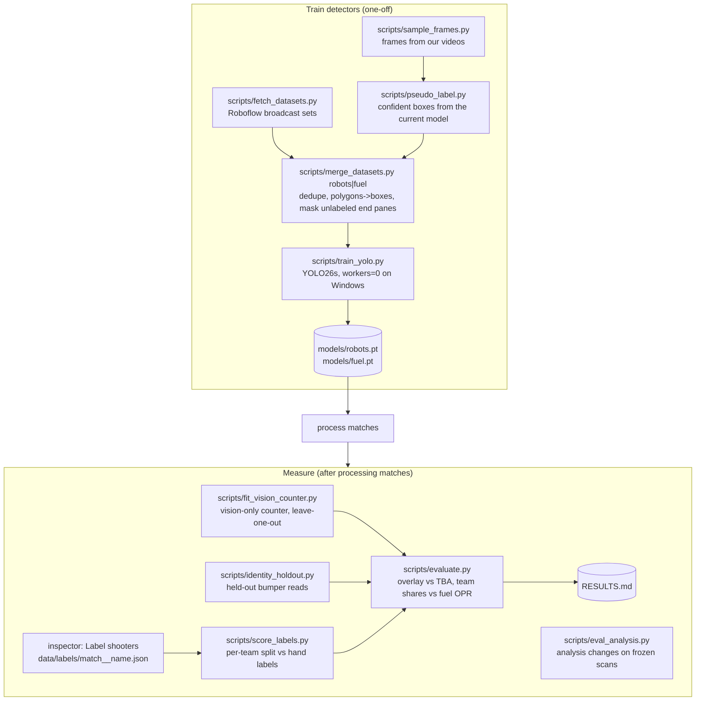

# How auto-scout works, from entry point to exit point

This page is the map of the system: which command starts what, which module does each step,
what data flows between them and which files come out at the end. The diagrams are UML
(activity, sequence, class and component diagrams) written in Mermaid. They render on GitHub, in
VS Code with a Mermaid extension, and in the match inspector (`python -m autoscout.inspector`, tab
"How it works"). Static SVG and PNG copies of every diagram are in
[`docs/diagrams/`](diagrams/) (regenerate with mermaid-cli after editing this file).

## 1. Running it yourself

All commands run from the repository root with the project virtualenv.

| You want to… | Command | Entry point |
| --- | --- | --- |
| process one match | `.venv/Scripts/python -m autoscout 2026casnv_qm2 --debug` | `autoscout/__main__.py` → `pipeline.process_match` |
| process a team's matches at events (parallel) | `.venv/Scripts/python scripts/run_batch.py --team 5026 --events 2026casnv 2026joh --shard 0/3` (run `1/3`, `2/3` alongside) | `scripts/run_batch.py` → `pipeline.process_match` |
| download videos only | `.venv/Scripts/python scripts/download_videos.py --team 5026 --events 2026casnv` | `video.download` (yt-dlp) |
| re-run only the analysis (seconds) | `.venv/Scripts/python -c "from autoscout import pipeline; pipeline.reanalyse('2026casnv_qm2')"` | `pipeline.reanalyse` (uses `output/<match>/scan.pkl`) |
| rebuild every report + RESULTS.md | `.venv/Scripts/python scripts/finalize.py` | `scripts/finalize.py` |
| browse / diagnose matches | `.venv/Scripts/python -m autoscout.inspector --open` → http://localhost:8765 | `autoscout/inspector/server.py` |
| annotated video of a match | `.venv/Scripts/python -m autoscout.render 2026casnv_qm2` | `autoscout/render.py` |
| label who shot each scoring burst (per-team ground truth) | inspector → open a match → **Label shooters**; then `.venv/Scripts/python scripts/score_labels.py` | `autoscout/labels.py`, `scripts/score_labels.py` |
| run the tests | `.venv/Scripts/python -m pytest tests -q` | `tests/` |

Prerequisites: `.env` with `TBA_API_KEY` (and `ROBOFLOW_API_KEY` for dataset downloads), the
models in `models/` (`robots.pt`, optional `fuel.pt`), an NVIDIA GPU for speed (CPU works, slowly).

## 2. The whole run, entry to exit (activity diagram)

## 3. Who calls whom for one match (sequence diagram)

## 4. Inside `scan_video`: the per-frame loop (activity diagram)

## 5. Inside `analyse`: from detections to per-team fuel (activity diagram)

## 6. Data model (class diagram)

## 7. Modules and what depends on what (component diagram)

## 8. Offline: training the models and measuring accuracy

**Per-team ground truth (shooter labels).** TBA and the scoreboard only give alliance totals, so
the per-team split is checked against hand labels. `labels.bursts` cuts each alliance's overlay
counter into scoring bursts (increments at most 1.5 s apart, at most 5 s long). In the inspector's
**Label shooters** mode a labeller watches each burst (from 4 s before the first ball, slowed to
0.5×) and marks which of the alliance's three robots launched those balls (keys 1/2/3, H = no robot,
U = unsure). Labels save straight away to `data/labels/<match>__<labeller>.json`, one file per person
so several people can label the same match. `scripts/score_labels.py` compares the balls
`fuel_log` credited inside each labelled burst with the label and with two baselines that need no
video (an even 1/3 split and a fuel-OPR split). It reports the share of balls credited to a robot
that really shot, the team-match error, the correlation and how often labellers agree, and it writes
`data/exp_labels/RESULTS_section.md`, which `scripts/evaluate.py` appends to `RESULTS.md`.

## 9. What comes out, and where to look

| File | Written by | What it is |
| --- | --- | --- |
| `output/<match>/result.json` | `pipeline.analyse` | per-team fuel (total, by period), tower and total points, paths, launches, identity segments, overlay timeline, credit log |
| `output/<match>/dets.json` | `pipeline.analyse` | every robot detection: time, view, box, alliance, assigned team, segment |
| `output/<match>/scan.pkl` | `pipeline._save_scan` | the expensive scan, so `reanalyse` takes seconds |
| `output/<match>/report.html` | `report.write_html` | per-team table and plots |
| `output/index.html` | `report.write_index` | list of all match reports |
| `output/team_5026.md`, `team_5026_autos.png` | `scripts/team_summary.py` | one team across all its matches |
| `RESULTS.md` | `scripts/evaluate.py` | accuracy numbers |
| `data/cache/overlay_<match>.json` | `overlay.scan` | raw scoreboard OCR reads (delete to force a re-read) |
| `data/labels/<match>__<labeller>.json` | inspector, Label shooters (`labels.save`) | hand labels: who launched each scoring burst (labeled / unsure / other / skip) |
| `data/exp_labels/RESULTS_section.md`, `score.json` | `scripts/score_labels.py` | per-team attribution vs the hand labels |
| `data/videos/<match>.mp4` | `video.download` | the downloaded match video |

## 10. Knobs that matter

| Where | Name | Effect |
| --- | --- | --- |
| `pipeline.Options` | `det_hz`, `fuel_step` | how often robots / fuel are analysed (speed vs detail) |
| `pipeline.Options` | `ocr_budget`, `w_ocr`, `w_app`, `switch_cost` | identity: how many bumper reads, evidence weights, how sticky labels are |
| `pipeline.Options`, `ocr.py` | `ocr_per_s`, `ocr_seg_cap`, `ocr_all_cached`, `ocr.PREP_H` | bumper reads per track (one per 2 s of a long track, up to 40), reuse of cached reads, upscaling before OCR (128 px) |
| `pipeline.py` | `SHOT_GATE`, `LAUNCH_ABOVE_MAX`, `RISE_ABOVE_MIN`, `INBOX_MAX`, `SIDE_MARGIN`, `PROJ_RISE_M` | launch-arc gate: an arc only counts if it starts just above a robot, over it, and climbs clear of it (drops hopper rattle, bounces, human-player throws) |
| `attribution.py` | `LAG_LO`, `LAG_PEAK`, `LAG_HI`, `PRIOR`, `HIDDEN` | launch -> counter delay window, the credit an in-zone robot gets without visible launches, and the pseudo-launches a hidden robot gets |
| `robots.py` | `FUSION`, `CHI2_GATE`, `TRACK_CHI2`, `SWAP_DIST` | multi-camera fusion and tracking |
| `field.py` | `in_alliance_zone(margin)` | how close to the zone line counts as "in zone" |
